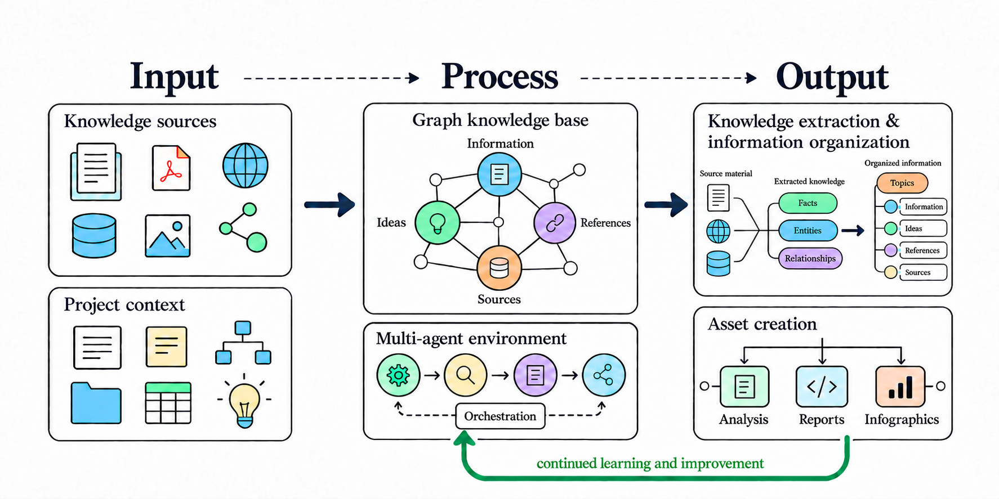

<h1 align="center">Knowledge-worker</h1>

<p align="center">
  <strong>Graph-based knowledge bases maintained by multi-agent work.</strong>
</p>

<p align="center">
  
</p>


<p align="center">
  <a href="https://github.com/kochf1/knowledge-worker/releases">
    
  </a>
  <a href="https://www.python.org/">
    
  </a>
  <a href="skills/INFO.md">
    
  </a>
</p>

## What is Knowledge-worker?

Knowledge-worker is a graph-based knowledge base that organizes shared
information by topic. It gives research groups, office teams, and project teams
a practical way to build knowledge for any area of work, such as a literature
review, a policy, or project discovery. You can add source material, including
PDFs, record what it means, and review what the team already knows.

The multi-agent structure maintains the knowledge base by organizing notes,
links, ideas, and files into named topics and keeping their navigation current.
Teams can extend the structure with approved skills for work such as answering
questions from recorded material, preparing reports, creating workflows, and
building dashboards. It gives people and organizations a structured path toward
AI-driven knowledge management.


### What makes it different?

**Well-structured knowledge topics.** Each topic keeps information, ideas,
references, and source files in clear, separate records, making it easier to
understand what is known, what is still being explored, and where it came
from.

**Maintained information navigation.** Main and local INFO documents are kept
current so people and agents can quickly find skills, topics, and the relevant
working records.

**Clear multi-agent definitions.** The project documents how an orchestrator,
agent roles, and reusable skills work together, so multi-agent work has a
shared structure with clear working guidance.

## Getting started

To start, clone the repository into a folder of your choice. Cloning copies the
complete structure into that folder, which becomes an independent knowledge
base for your topics and material.

```sh
git clone https://github.com/kochf1/knowledge-worker.git /path/to/your-knowledge-base
cd /path/to/your-knowledge-base
```

If you prefer a release package, download the latest archive, extract it into
your chosen folder, and open that folder:

```sh
curl -L https://github.com/kochf1/knowledge-worker/releases/latest/download/knowledge-worker_latest.zip
unzip knowledge-worker_latest.zip -d /path/to/your-knowledge-base
cd /path/to/your-knowledge-base
```

With the structure installed, use one of the public actions below to begin
organizing knowledge.

## Available actions

- `Show info` opens the main project information document.
- `Show info {area}` opens the information document for a confirmed local area.
- `Create topic {topic}` creates a structured, empty knowledge topic.
- `Learn info about {topic}` adds supplied, attributed material to an existing topic.
- `Maintain assets {request}` classifies, adds, inspects, or reports on approved project assets.
- `GitHub status` provides a read-only report of the local repository, remote,
  branch, and release state.
